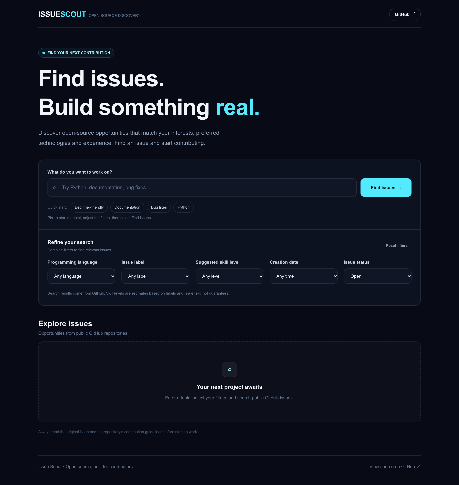

# Issue Scout

Find relevant GitHub issues according to your likes and skills.

Issue Scout is an open source discovery application that looks through public GitHub issues for you and sorts out relevant ones according to their keywords, language, labels, skill level required, dates, and issue status.



[](https://issue-scout-chi.vercel.app/)

## Quick Start

Open the [live app](https://issue-scout-chi.vercel.app/), search for a topic or programming language, and filter the results to find an issue you might want to work on. You can preview an issue before opening it on GitHub.

## Features

- **Issue search:** Find public GitHub issues using keywords, programming language, labels, and issue status.
- **Difficulty filters:** Browse issues by suggested beginner, intermediate, or advanced level, based on their labels.
- **Issue previews:** View issue details, repository information, and contribution guidance without immediately leaving the app.
- **Repository and issue checks:** See repository health information, a readiness score, and issue availability signals before getting started.
- **Saved issues:** Bookmark issues and return to them later. Saved issues remain in your browser.
- **Contribution tracking:** Keep a checklist, record your progress and notes, and save a pull request URL for each issue.
- **Shareable links:** Share searches with their filters or link directly to a specific issue preview.

## Run Locally

### Requirements

- Node.js 20.9 or newer
- npm

### Installation

Clone the repository, install its dependencies, and start the development server:

```bash
git clone https://github.com/sharmao07/issue-scout.git
cd issue-scout
npm install
npm run dev
```

Open [http://localhost:3000](http://localhost:3000) in your browser.

No environment variables are required for the current version.

### Useful Commands

| Command | Description |
| --- | --- |
| `npm run dev` | Starts the development server |
| `npm run test` | Runs the tests |
| `npm run lint` | Lints code with ESLint |
| `npm run build` | Builds project for production |

## How It Works

Issue Scout uses Next.js and React as the front-end technology with TypeScript and Tailwind CSS as an application language and styling framework respectively. Next.js route handlers pull the public GitHub issues and repository data and serve it to the front end.

Filters are meant to help you find suitable issues to look through. The difficulty level suggestions depend on the labels on the issue whereas the contribution readiness score relies on the available issue and repository signals. It is only an estimate, however, so do not forget to check the issue itself and repository contribution guidelines.

Issues saved and contribution progress are kept in browser local storage, allowing you to continue working on them without an Issue Scout account.

## Credits

- [GitHub REST API](https://docs.github.com/en/rest) for publicly available issue and repository information.
- [Next.js](https://nextjs.org/) and [React](https://react.dev/) for the application framework.
- [Tailwind CSS](https://tailwindcss.com/) for styles.
- [Vitest](https://vitest.dev/) for testing.

## License

Issue Scout is licensed under the MIT License. See [LICENSE.md](https://github.com/sharmao07/issue-scout/blob/main/LICENSE.md) for details.
